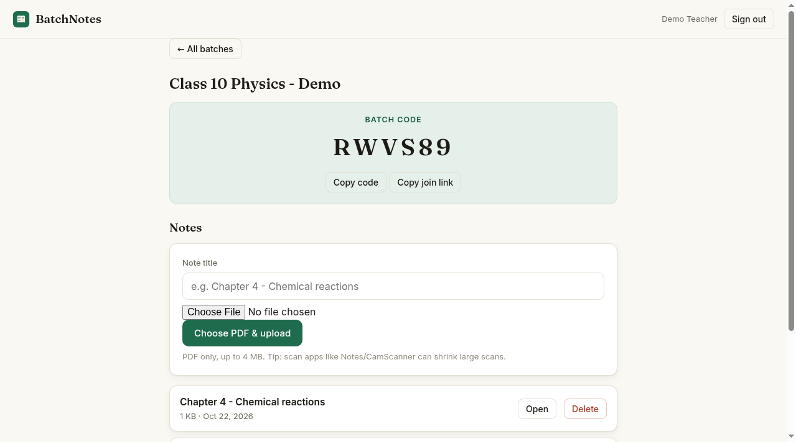
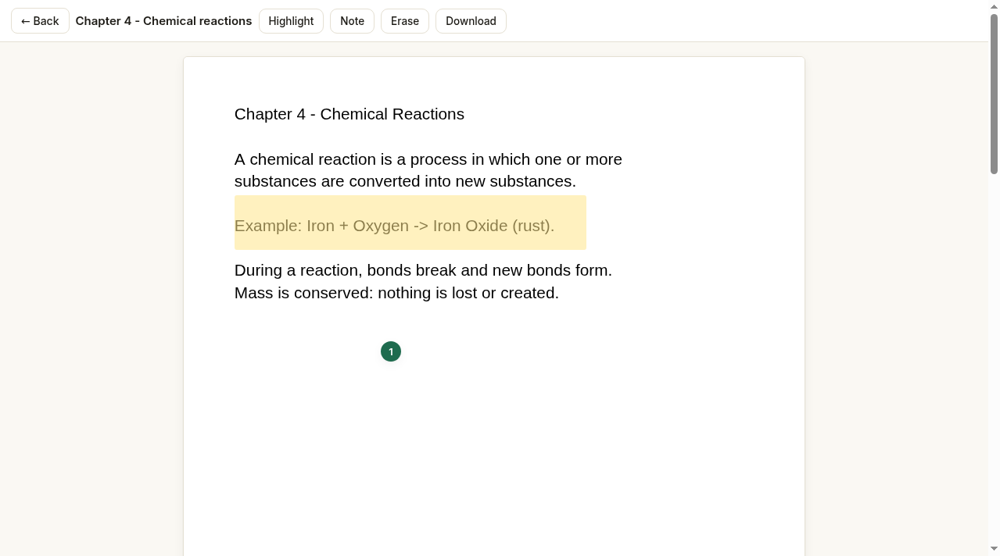

# BatchNotes

**Teachers share PDF notes with their class. Students read, highlight and keep their own annotated copy.**

Live: **https://dev-stack12692.github.io/batchnotes/**

## How it works

1. A teacher signs up (email + password) and creates a **batch** - one per class or subject.
2. Each batch gets a unique **6-character code**. The teacher shares the code (or a join link) with students.
3. The teacher uploads notes as **PDF** (up to 4 MB each).
4. Students open the site, tap "Join a batch", enter the code and their name - **no account needed**.
5. Students read the notes and add **highlights and sticky notes on their own copy**. Their copy saves automatically and stays private to them; the teacher's original PDF is never changed.
6. The teacher sees who joined and can add or remove notes any time.

## Features

- Teacher accounts with any number of batches
- Unique join code + shareable join link per batch
- PDF upload with progress (4 MB cap keeps everything on the free tier)
- In-browser PDF reader (PDF.js) that works on phone, tablet and desktop
- Student annotations: highlight regions + pinned text notes, auto-saved per student
- Download the original PDF
- Teachers can see the list of students who joined

## Tech

- Single static page (`index.html`) - no build step, hosted on GitHub Pages
- Firebase (Spark free plan): Authentication (email/password for teachers, anonymous for students) + Cloud Firestore
- PDFs are stored as chunked Base64 documents inside Firestore, so no paid Cloud Storage (Blaze) is needed
- [PDF.js](https://mozilla.github.io/pdf.js/) from CDN for rendering
- Security rules in `firestore.rules`: teachers write their own batches, students read batches they join, annotated copies are private to each student

## Run locally

Any static file server works:

```bash
npx serve .
```

Then open the printed URL. The Firebase project config is already in `index.html`.

## Screenshots

| Teacher dashboard | Student reading + annotations |
| --- | --- |
|  |  |
